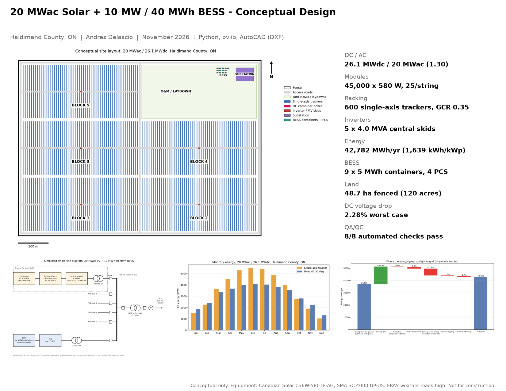
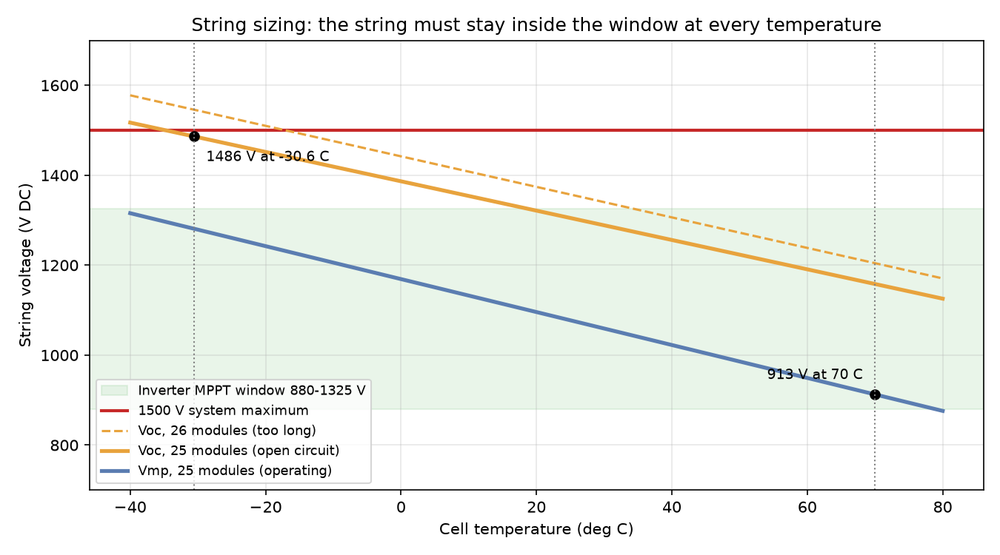
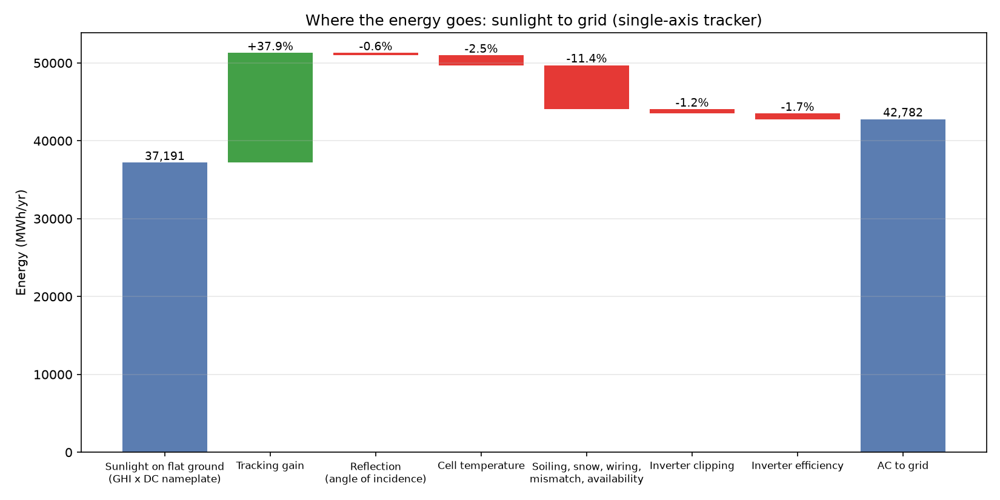
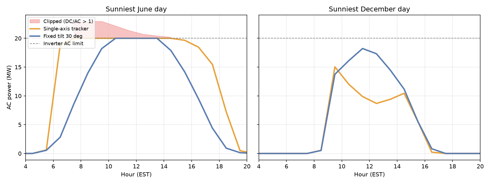
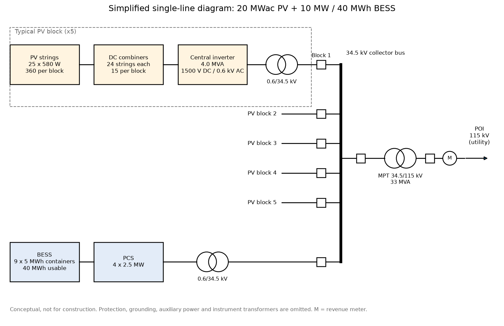

# Conceptual Design: 20 MWac Solar + 10 MW / 40 MWh BESS, Southern Ontario

A concept-stage design package for a greenfield, utility-scale solar plant with battery storage,
built in Python and exported to AutoCAD. One command runs string sizing, plant sizing, site
layout, DC voltage drop, a typical-year energy model, a quantity takeoff, automated QA/QC
checks, and every drawing below.



> **Conceptual only.** Equipment values come from real manufacturer datasheets (see
> [Data sources](#data-sources)); the site is a placeholder parcel. Every assumption lives in
> [`basis.py`](basis.py), and changing it recalculates everything.

## What's in the package

| Deliverable | File | Design task it represents |
|---|---|---|
| Design basis | [`basis.py`](basis.py) | Codes, specs and assumptions in one place |
| String sizing + voltage window | [`electrical.py`](electrical.py), [`string_window.png`](out/string_window.png) | Electrical calculations |
| Site layout (AutoCAD DXF + PNG) | [`layout.py`](layout.py), [`site_layout.dxf`](out/site_layout.dxf) | Conceptual greenfield layout |
| DC voltage drop from layout lengths | [`electrical.py`](electrical.py) | Electrical analysis |
| Single-line diagram | [`single_line_diagram.png`](out/single_line_diagram.png) | Preliminary electrical system modelling |
| Energy model, loss waterfall, tracker vs fixed | [`energy.py`](energy.py) | Preliminary production modelling |
| Quantity takeoff | [`takeoff.csv`](out/takeoff.csv) | Quantity takeoffs |
| BESS sizing | [`electrical.py`](electrical.py) | Battery Energy Storage Systems |
| Automated QA/QC checks | [`main.py`](main.py), [`summary.txt`](out/summary.txt) | Package QA/QC, quality checklists |

## Results

| | |
|---|---|
| Plant | 20.0 MWac / 26.10 MWdc (DC/AC 1.30), 5 blocks × 4.0 MVA central inverters |
| Strings | 25 × 580 W modules, 1,800 strings, 45,000 modules |
| Racking | 600 single-axis trackers (1P, 75 modules), GCR 0.35, 6.51 m row pitch |
| Annual energy | 42,780 MWh, 1,639 kWh/kWp, 24.4% AC capacity factor |
| Tracker vs fixed 30° | +15.2% annual energy |
| DC voltage drop | 2.28% worst-case circuit (0.72% string + 1.56% feeder) |
| Land | 48.7 ha (120 acres) fenced |
| BESS | 9 × 5 MWh containers, 4 × 2.5 MW PCS, AC-coupled at 34.5 kV |

### String sizing
The string has to stay below 1,500 V on the coldest morning and above the inverter's MPPT
minimum on the hottest afternoon. With this module and inverter, 25 modules is the only
length that fits.



### Energy




Trackers win in summer, but **fixed tilt wins on sunny winter days**. At noon in December a
tracker lies flat while a 30° fixed panel faces the low sun. DC/AC 1.30 clips about 1.3% of
energy in exchange for much more output in the morning and evening.

### Single-line diagram


## Trade studies (answer key from the scenarios in [GUIDE.md](GUIDE.md))

| DC/AC | MWh/yr | kWh/kWp | Clipping | Fenced ha |
|---|---|---|---|---|
| 1.10 | 36,787 | 1,658 | 0.1% | 41.8 |
| 1.20 | 39,909 | 1,653 | 0.4% | 45.6 |
| **1.30** | **42,782** | **1,639** | **1.3%** | **48.7** |
| 1.40 | 45,285 | 1,614 | 2.8% | 52.6 |
| 1.50 | 47,458 | 1,581 | 4.8% | 55.7 |

## QA/QC (automated; the run fails if any check fails)

- [x] Cold Voc string ≤ 1,500 V system maximum
- [x] Hot Vmp string ≥ inverter MPPT minimum
- [x] Cold Vmp string ≤ inverter MPPT maximum
- [x] DC/AC ratio within 1.20–1.40
- [x] Worst-case DC voltage drop ≤ 3%
- [x] Trackers drawn in the layout = trackers sized
- [x] Main power transformer ≥ PV + BESS export
- [x] Specific yield within a plausible range for southern Ontario

## Known limitations / next steps

- **Weather is optimistic.** In North America PVGIS uses ERA5 reanalysis, which reads high compared with satellite data (the +38% tracking gain is a symptom). Next: cross-check in PVsyst with Meteonorm, or with NREL NSRDB.
- The module is bifacial (80% bifaciality), but rear-side gain isn't modelled (conservative). Snow loss is a flat 3%, not seasonal.
- The SMA inverter needs its −37 °C cold-climate option (standard range stops at −25 °C), and its 4,000 kVA rating at 35 °C is specified at ≤ 1,050 V DC; neither is modelled.
- Rectangular site with a generic yard. A real parcel needs setbacks, wetlands, drainage and topography (Civil 3D).
- Conductor ampacity and AC studies (load flow, short circuit, arc flash in ETAP) aren't done.
- Code reference to confirm against the current edition: CSA C22.1 (Canadian Electrical Code) Section 64, as adopted by the Ontario Electrical Safety Code.

## Data sources

| Input | Source |
|---|---|
| PV module | Canadian Solar CS6W-580TB-AG (TOPBiHiKu6), datasheet V2.1, Apr 2025 |
| Inverter | SMA Sunny Central SC 4000 UP-US, datasheet SCXXXXUP-US-DS-en-27 |
| Design temperatures | ASHRAE 2017 Fundamentals, Hamilton Intl (WMO 712630): 50-year low −30.6 °C, mean extreme low −21.7 °C. Both give 25 modules per string |
| Weather (energy model) | PVGIS typical meteorological year (ERA5) |

## Run it

```bash
python -m venv .venv
.venv\Scripts\python -m pip install -r requirements.txt
.venv\Scripts\python main.py
```

The first run downloads typical-year weather from PVGIS and caches it in `out/tmy.csv`. To
use your own parcel, change `SITE` in `basis.py` and delete `out/tmy.csv`.
